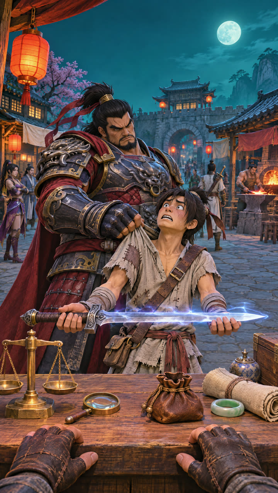
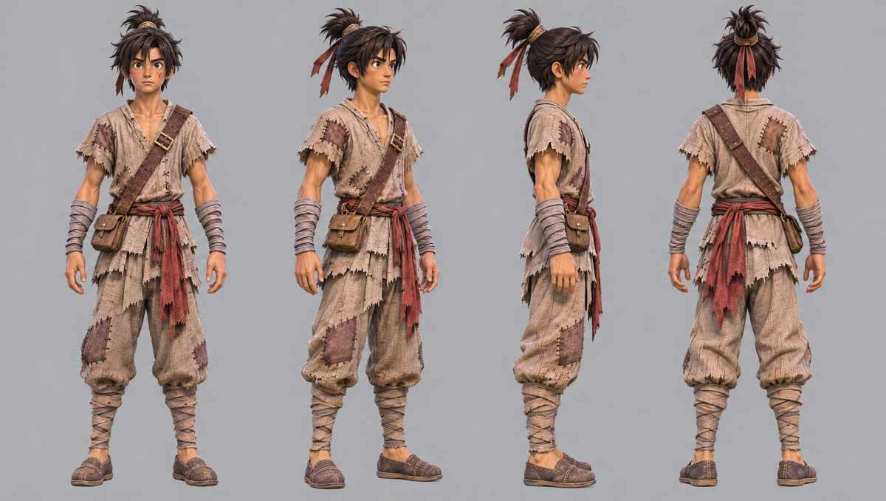
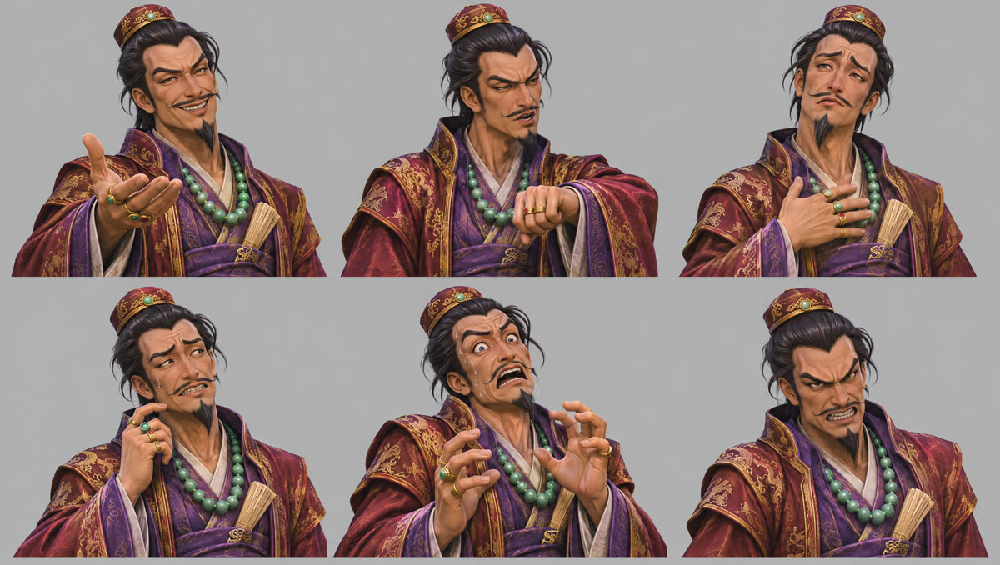
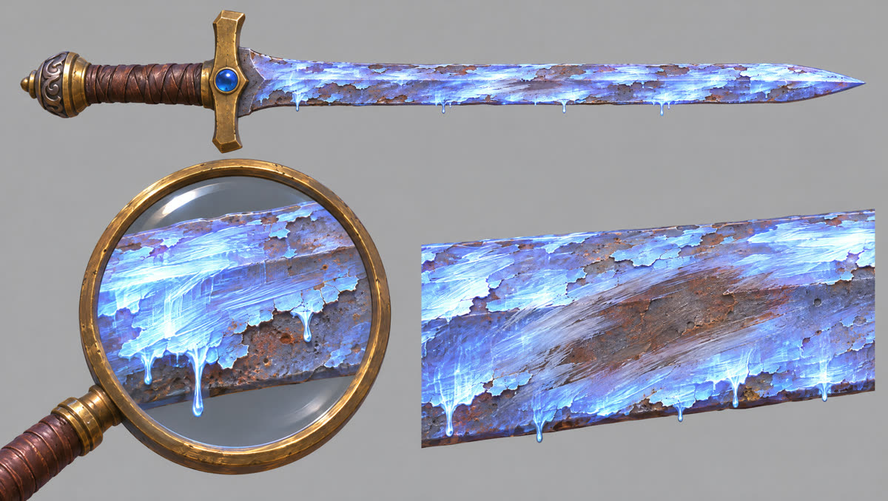
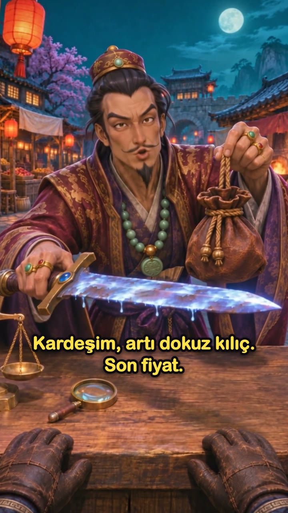
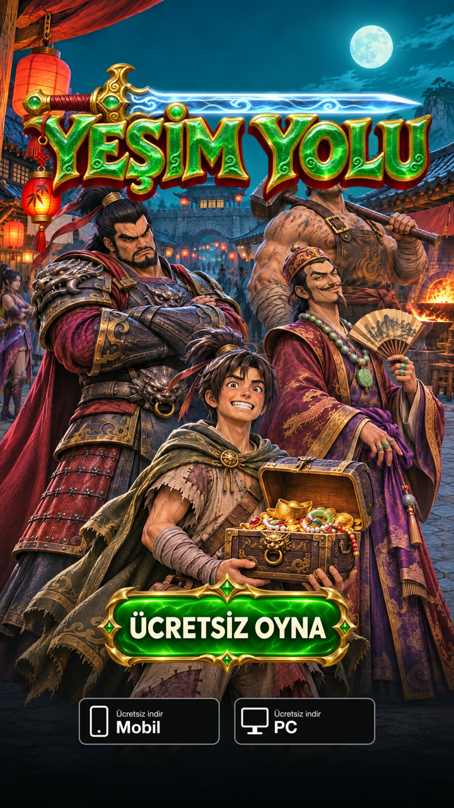

# Oyun reklamı: videodaki bütün promptlar

[VİDEO BAŞLIĞI VE LİNKİ] videosunun eki. Videoda Claude ve Seedance 2.5 ile,
çekim yapmadan 55,8 saniyelik dikey bir oyun reklamı ürettik. Bu sayfa o işin
tarifi: Claude'a verdiğim promptlar ve Claude'un modellere gönderdiği
promptların aslı, kullanıldıkları sırayla.

Oyun kurgusal: "Metin 2 benzeri, ticaret dönen bir MMORPG". Adı yer tutucu,
Yeşim Yolu.



## Nasıl kullanılır

- **Kolay yol:** 1. bölümdeki promptları kendi ürününe uyarlayıp Claude'a
  sırayla ver. 2. bölümdeki promptları Claude (bu videoda Fable modeli)
  kendisi yazar; ne beklemen gerektiğini görmek için oku.
- **Elle yol:** 2. bölümdeki promptları doğrudan modellere ver. Oyun, karakter
  ve mekan tariflerini kendininkiyle değiştir, iskeleti koru.
- Kurulum: depodaki [`higgsfield-generate`](../skills/higgsfield-generate/)
  skill'i ve Higgsfield bağlantısı (bkz. [README](../README.md)). Bütün
  üretimi Claude Code, Higgsfield CLI üzerinden gönderdi. Videoda "MCP"
  diyorum; bu oturumda bağlantı CLI'dı. MCP de aynı işi görür, iki kurulum
  da README'de.

Kullanılan modeller (hepsi Higgsfield içinde):

| iş | model |
|---|---|
| görsel (tarz, karakter, eşya, mekan, logo, düğme) | GPT Image 2.6, 2K, kalite yüksek |
| replikler | ElevenLabs v4 |
| müzik | ElevenLabs Music v2.5 |
| video | Seedance 2.5, omni reference modu, 720p |
| birkaç ses efekti | Mirelo text-to-audio |

Reklamın sesini yazıya çevirmek ve replikleri kontrol etmek için Whisper
kullanıldı; benim bilgisayarımda çalışıyor.

Higgsfield: [HIGGSFIELD LİNKİ]

## 1) Claude'a verdiğim promptlar

Videoda kağıt olarak gösterilen on prompt. Çoğunu sesle söyledim; kağıttaki
hali temizlenmiş ve kısaltılmış, anlamı aynı. Zamanlar videodaki yer.

| # | video | nasıl | prompt | ne işe yaradı |
|---|---|---|---|---|
| 1 | 1:36 | yazıyla, reklam dosyasını sürükleyerek | Bu reklam videosunu incele. Kare kare bak, sesini de dinle. Neden tutuyor, arkasındaki mantık ne? | Claude videoyu karelere böldü, sesi Whisper ile yazıya çevirdi ve reklamın iskeletini çıkardı. |
| 2 | 3:28 | sesle | Oyunumuz Metin 2 benzeri bir MMORPG olsun. İçinde oyuncular arası ticaret dönüyor. Bu oyun için aynı mantıkta bir reklam filmi yapsak nasıl olur? Bir hikaye kur. | Aynı iskeleti kendi oyunumuza taşıyan üç sahnelik hikaye çıktı (aşağıda). |
| 3 | 3:47 | sesle | Seedance Türkçe seste sorun çıkarıyor ama en kaliteli video modeli o. Sesleri ElevenLabs'te üretip Seedance'e referans olarak mı verelim? | Sıra kilitlendi: önce ses, sonra video, en son asıl ses geri bindirilir. |
| 4 | 3:56 | sesle | Toplam 40-50 saniyelik bir demo yapacağız: 3 sahne üretip birleştiririz. Başlamadan önce tarzı kilitleyelim. Bana tarz öner. | Üç tarz önerisi geldi: stilize 3D, eski MMORPG yenilenmiş, hamur animasyon. |
| 5 | 4:09 | yazıyla | 2. Eski MMORPG, yenilenmiş. Bu tarz olsun. Bununla ilgili 2 farklı referans üret: GPT Image 2.6 ile, Higgsfield'dan. | Aynı sahnenin iki tarz karesi üretildi; B'yi seçtim. |
| 6 | 4:32 | sesle | Tamam, B'yi kullanalım. Tüm hikaye için gereken görselleri üret: farklı açılardan karakter sheet'leri, eşyalar, mekan. Hepsini paralel üret, bu tarza sadık kal. Video üretirken bol bol referans vereceğiz. | 16 görsellik referans paketi paralel üretildi (aynı anda 6 iş). |
| 7 | 5:06 | sesle | Şimdi hem sesi hem müziği üret. Seslendirme ElevenLabs v4 ile olsun. Arka plan müziğini Higgsfield'ın müzik modeliyle yap. | 25 replik ve iki müzik adayı çıktı. |
| 8 | 5:34 | Claude yazdı | Seedance'e giden sahne 1 promptu (tam metni 2.5'te) | Benim yazmadığım, Claude'un sahne başına hazırladığı video promptu. |
| 9 | 6:24 | sesle, ekran görüntüsüyle | Son sahneyi yeniden üretelim: kılıcı kınına yanlış koyuyor. Daha fazla görselle destekle, kılıcı kınına koymayı farklı açılardan göster. | Bozuk sahne düzeldi (2.6). Kağıtta "son sahne" yazıyor; kastettiğim, ekran görüntüsünü attığım sahne 1. |
| 10 | 7:15 | sesle | Karakter iki seçenekten birine tıklıyor: "Yardım et" ya da "Karışma". Tıkladığı anda düzgün bir tıklama animasyonu olsun. Tik ve çarpılar doğru anda gelsin, efekt seslerini de ekle. | Efekt katmanı kodla yeniden kuruldu, 56 efekt sesi eklendi (2.7). |

Bunların arasında kısa onaylar da var ("B güzel", "720p üret, taslak
yapmayalım"); onları tabloya koymadım.

### Ortaya çıkan hikaye

İzleyici pazardaki tüccar; kamera onun gözü, eldivenli elleri hep kadrajda.

- **Sahne 1:** Bir çaylak parlayan bir kılıçla geliyor, arkasında dev bir
  zırhlı "Çaldı, o kılıç benim" diyor. Tüccar iki kontrol yapıyor: kabzadaki
  damga tutmuyor, kılıç zırhlının kınına girmiyor. Seçim: YARDIM ET mi,
  KARIŞMA mı.
- **Sahne 2:** Bir dolandırıcı "artı dokuz" kılıç satıyor. Büyüteçle bakınca
  parıltı boya, kesenin altı çakıl. Tente dolandırıcının üstüne çöküyor.
- **Sahne 3:** Kurtarılan çaylak zengin dönüyor, bir sandık altın bırakıyor.
  Seçim: tezgahı büyüt mü, artı dokuz dene mi. Demircide çekiç inerken kesme,
  kapanış kartı.

Reklamdan alınan iskelet: ilk saniyede çatışma, oyuncunun gözünden çekim, iki
vaka, iki kontrol, bir seçim, baştakinin geri dönüşü, oyunun adı en sonda.

## 2) Claude'un modellere gönderdiği promptlar

Aşağıdakiler modele giden metinlerin aynısı, İngilizce aslıyla. Her işte
tekrar eden ortak bloklar (tarz kilidi, sahne promptlarının ortak girişi) bir
kez verildi, altlarda tekrar edilmedi.

### 2.1 Tarzı kilitle

Görselden önce tek bir tarz karesi. Sonraki her görsele bu kare referans
olarak eklendi. Ayar: GPT Image 2.6, 9:16, 2K, kalite yüksek.

Tarz B (seçilen):

```text
Vertical 9:16 key frame from an in-engine cutscene of a fantasy MMORPG, rendered in the style of a faithful upscaled remaster of an early-2000s Far Eastern martial-arts online role-playing game: chunky, slightly stylized 3D game character models with bold silhouettes, saturated colors, hand-painted textures sharpened to HD, simple clean real-time lighting, a nostalgic PC online game look. Not a photograph, not a Pixar-style cartoon.

First-person point of view from behind a wooden market stall: at the very bottom of the frame, two hands in worn dark leather gloves rest on the stall counter (the viewer is the merchant). On the counter: a small brass scale, a round magnifying lens, a leather coin pouch, a few trade goods.

In front of the stall, facing the viewer: a scrawny young newbie adventurer in patched pale linen clothes and cheap leather straps, wide-eyed and nervous, holding a long sword with a faint blue-white magical glow along the blade out across the counter. Directly behind him looms a huge warrior in heavy ornate dark steel and red lacquer armor, gripping the newbie by the collar with one gauntlet, scowling down at him.

Setting: a night market in a walled village square. Curved tiled roofs, wooden stalls lit by glowing red and orange paper lanterns, plain cloth banners with no writing, a blacksmith's forge with an anvil glowing in the background, other adventurers standing around in soft focus, a moonlit teal night sky. Lantern orange against moonlight teal.

Composition: medium shot, both characters framed from the waist up in the middle of the frame, the counter and gloved hands in the lower third, calm uncluttered space in the upper third. No text, no letters, no numbers, no user interface, no HUD, no health bars, no watermark, no logos.
```

Tarz A (seçilmeyen) aynı sahneyi 2000'lerin ortası, yarı gerçekçi bir oyun
görünümünde, gün batımında bir kervansaray pazarında kuruyordu.

Tarz kilitlendikten sonra her referans promptunun sonuna bu blok eklendi ve
tarz karesi her işe görsel referans olarak verildi:

```text
Art style: a faithful upscaled HD remaster of an early-2000s Far Eastern martial-arts fantasy MMORPG. Chunky, slightly stylized 3D game character models with bold silhouettes, saturated colors, hand-painted textures sharpened to HD, clean real-time game lighting. Match the art style, rendering, proportions and color treatment of the attached style reference image exactly. Not a photograph, not a Pixar-style cartoon. No text, no letters, no numbers, no labels, no captions, no arrows, no user interface, no watermark, no logos.
```

### 2.2 Referans paketi

Mantık: video modeline ne kadar çok ve tutarlı referans verirsen o kadar az
uydurur. Karakterler, eşyalar ve mekan ayrı ayrı üretildi, aynı anda 6 iş.
Sayfalar 16:9, kareler 9:16.

```text
[sayfa şablonu] + [karakter / eşya / mekan tarifi] + [tarz kilidi]
referans görseller: tarz karesi (+ gerekiyorsa önceki dalganın çıktıları)
```

| dalga | ne | adet |
|---|---|---|
| 1 | 4 karakter dönüş sayfası, 3 ifade sayfası, tüccarın eldivenli elleri, 5 eşya sayfası (gerçek kılıç, sahte kılıç, kese ve sandık, aletler, tezgah), 3 boş mekan plakası | 16 |
| 2 | her sahnenin başlangıç karesi (dalga 1 çıktıları referans) | 4 |
| 3 | düzeltme: zırhlının kını, adım adım kına sokma, kına sokma anının başlangıç karesi (2.6) | 3 |

Önemli ayrıntı: bir karakteri her promptta aynı cümleyle tarif et. Çaylağın
tarifi hangi görselde geçiyorsa kelimesi kelimesine aynı.

Karakter dönüş sayfası (çaylak):

```text
Character turnaround sheet. Four full-body views of the same single character standing in a relaxed neutral pose, evenly spaced in one row: front view, three-quarter view, side profile, back view. Plain flat light-grey background, even neutral studio lighting, the whole body visible from head to toe in every view, identical outfit, face and proportions in every view. Character: the scrawny young newbie adventurer from the style reference image: about 18 years old, messy dark brown hair tied in a small topknot, big expressive dark eyes, a small scratch on his cheek, a patched pale linen tunic with torn short sleeves, cloth wrist wraps, a brown leather cross-body strap, a small leather belt pouch, a faded red cloth sash, loose linen trousers and simple cloth shoes.
```



İfade sayfası (dolandırıcı; hikayede geçen altı ifade, sırasıyla):

```text
Character expression sheet. Six head-and-shoulders portraits of the same single character arranged in a clean grid of three columns and two rows on a plain flat light-grey background, even neutral lighting, identical face, hair and outfit in every portrait. Character: a smooth-talking con-man merchant: about 45 years old, tall and slim, an oily charming smile, a thin curled moustache and a small pointed goatee, narrow sly eyes, a small round embroidered silk cap, a long wine-red silk robe with purple lining and gold embroidery, very wide sleeves, several gold rings, a jade bead necklace, a folded fan tucked into a purple sash. Expressions, in order: warm charming salesman smile; impatient and hurried; fake wounded innocence; nervous with a bead of sweat; caught and panicking; furious snarl with bared teeth.
```



Eşya sayfası (sahte kılıç; hikayenin kanıtı olan ayrıntılar ayrı ayrı
çizdirildi). İlk denemede sayfaya bir el girdi; son cümle o yüzden var:

```text
Prop design sheet on a plain flat light-grey background, even lighting. Subject: a cheap FAKE copy of an enchanted sword. A dull pitted iron blade crudely painted with glowing blue-white paint to imitate a magical glow; the paint is uneven, with visible brush strokes, drips and flaking patches that expose rusty metal; a plain brass crossguard with a blue glass bead instead of a gem. Three views: the full fake sword lying horizontally; an extreme close-up of the blade seen through a round brass magnifying lens showing the flaking glowing paint and the rust underneath; a close-up of one patch of the blade where the wet glowing paint has been wiped away in a single smeared streak, exposing bare rusty iron. No hands, no fingers and no people anywhere in the image.
```



Boş mekan plakası (tüccarın gözünden tezgah, kimse yok). Tarz karesinde
eldivenler parmaksız çıkmıştı; ellerin tarifi bu yüzden bu kadar ayrıntılı:

```text
Vertical 9:16 empty background plate. First-person point of view from behind a worn wooden market stall counter under a dark red cloth awning with one red paper lantern at the top left. At the very bottom of the frame: the merchant's own two hands seen in first person: full-fingered worn dark brown leather gloves with stitched seams that cover every finger and fingertip completely (no bare skin visible), and the cuffs of dark indigo quilted sleeves with a thin woven trim, resting on the counter. On the counter: a small brass balance scale, a round magnifying lens, a leather coin pouch, a few trade goods. Nobody is standing at the counter: the space directly in front of the stall is empty cobblestones. Setting: the night market square from the style reference image: a walled village square with curved tiled roofs, wooden stalls lit by glowing red and orange paper lanterns, plain cloth banners with no writing, a stone village gate in the back wall, a blacksmith's forge with an anvil glowing on the right, a pink blossom tree, cobblestones, a full moon in a teal night sky. Lantern orange against moonlight teal. A few adventurers stand far in the background in soft focus.
```

Başlangıç karesi (sahne 2). Karakter, eller ve mekan tarifleri yukarıdakilerin
aynısı, üstüne yalnız o anın pozu eklendi:

```text
Vertical 9:16 key frame from an in-engine cutscene. First-person point of view from behind the merchant's wooden market stall counter under a dark red awning. At the very bottom of the frame: the merchant's own two hands seen in first person: full-fingered worn dark brown leather gloves with stitched seams that cover every finger and fingertip completely (no bare skin visible), and the cuffs of dark indigo quilted sleeves with a thin woven trim, resting on the counter. Setting: the night market square from the style reference image: a walled village square with curved tiled roofs, wooden stalls lit by glowing red and orange paper lanterns, plain cloth banners with no writing, a stone village gate in the back wall, a blacksmith's forge with an anvil glowing on the right, a pink blossom tree, cobblestones, a full moon in a teal night sky. Lantern orange against moonlight teal. In front of the stall, facing the viewer and leaning in over the counter with a warm charming salesman smile: a smooth-talking con-man merchant: about 45 years old, tall and slim, an oily charming smile, a thin curled moustache and a small pointed goatee, narrow sly eyes, a small round embroidered silk cap, a long wine-red silk robe with purple lining and gold embroidery, very wide sleeves, several gold rings, a jade bead necklace, a folded fan tucked into a purple sash. With one ringed hand he slides a sword with a blue-white glowing blade across the counter toward the viewer; with the other hand he dangles a fat leather coin pouch. He is alone at the counter, framed from the waist up in the middle of the frame, counter and gloved hands in the lower third, calm space in the upper third. On the counter: a brass balance scale and a round magnifying lens.
```

### 2.3 Replikler ve ses

Seedance Türkçe diyalogda zayıf kalıyor. Bu yüzden sesler önce ElevenLabs v4
ile üretildi, video sonra bu sese göre.

Ses seçimi: 18 hazır ses aynı cümleyle denendi ("Kardeşim acelem var, kervan
kalkıyor. Son fiyat bu."); biri üretimde hata verdi, kalan 17'sinin perdesi
ölçüldü. En kalın ses zırhlıya, en incelerden biri çaylağa gitti; tüccarın
sesi daha önce beğendiğim bir ses. Seçilenler: çaylak Reid, zırhlı Gideon,
biz (tüccar) Arthur, dolandırıcı Knox, demirci Sterling, anons Barrett.

Her replik ayrı üretildi; başına köşeli parantezle oyunculuk etiketi kondu.
Etiket sese okunmuyor, oyunculuğu yönlendiriyor. Örnek:

```text
[panicked] Abi yemin ederim, çalmadım!
```

| sahne | kim | replik | etiket |
|---|---|---|---|
| 1 | Çaylak | Abi yemin ederim, çalmadım! | panicked |
| 1 | Zırhlı | Çaldı. O kılıç benim. | angry |
| 1 | Biz | Dur, bir bakayım. | calm |
| 1 | Biz | Damga tutmuyor. | |
| 1 | Zırhlı | Kınıma koy, görürsün. | annoyed |
| 1 | Biz | Bu kılıç senin değil. | firm |
| 1 | Çaylak | İmdat! Abi yardım et! | screaming |
| 1 | Biz | Bırak çocuğu. | cold, firm |
| 1 | Çaylak | Sağ ol abi! | relieved, grateful |
| 2 | Dolandırıcı | Kardeşim, artı dokuz kılıç. Son fiyat. | smooth, charming |
| 2 | Dolandırıcı | Vaktim yok, kervan kalkıyor. | |
| 2 | Biz | Bir bakayım. | calm |
| 2 | Biz | Bu boya. | |
| 2 | Dolandırıcı | Yağmurdan olmuş o! | defensive |
| 2 | Biz | Kesenin altı çakıl. | |
| 2 | Dolandırıcı | Aa! Kim koymuş onları? | fake surprise |
| 2 | Biz | Dolandırıcı. | flat |
| 2 | Dolandırıcı | Seni gebertirim! | furious, shouting |
| 3 | Çaylak | Abi! Sayende hayattayım. | happy |
| 3 | Çaylak | Bunlar senin. | warm |
| 3 | Biz | Eyvallah. | |
| 3 | Biz | Hadi, artı dokuz deneyelim. | decisive |
| 3 | Demirci | Emin misin evlat? | gravelly, slow |
| 3 | Biz | Bas! | tense, firm |
| kapanış | Anons | Yeşim Yolu. Kendin dene. Ücretsiz. | epic trailer voice |

Kontrol Whisper'la yapıldı: her sahnenin sesi yazıya çevrildi ve metinle
karşılaştırıldı. "Acelem var" üç denemede de "aselen" diye çıktı; noktalamayı
değiştirmek de etiketi silmek de işe yaramadı, cümleyi "Vaktim yok" yapmak
yaradı.

Sonra replikler kırpıldı (baştaki ve sondaki sessizlik), aynı seviyeye
çekildi ve her sahne için tek ses dosyası olarak dizildi. Replik arasındaki
boşluk elle belirlendi: o arada ekranda bir şey oluyorsa (büyüteçle bakış,
damga, seçim düğmesi) boşluk uzun tutuldu. Çıkan süreler: sahne 1 18,64 sn,
sahne 2 18,75 sn, sahne 3 13,24 sn, anons 3,67 sn. Videonun süresini bu
sayılar belirledi.

### 2.4 Müzik

ElevenLabs Music v2.5, 60 saniye, yalnız enstrümantal, iki aday. B seçildi
(ud ve saz). Diyalog altında her yerden kesilebilsin diye girişsiz, düz
enerjili istendi.

```text
Instrumental background score for a comedic fantasy bazaar skit on the Silk Road, in the spirit of a sneaky "detective inspection" cue. Mischievous, playful, slightly suspenseful. An oud and a saz play a bouncy staccato minor-key motif in a Middle Eastern scale, with pizzicato strings answering, darbuka and frame drum keeping a steady walking groove, a plucked upright bass, and short ney flute and kanun flourishes. Medium tempo around 112 BPM. Steady energy and volume from the first second to the last so it can sit under dialogue and be cut anywhere; no intro, no fade-in, no big drops, no vocals, no choir.
```

Aday A aynı tarifi guzheng, pipa ve bambu flütle kuruyordu.

### 2.5 Video sahneleri

Model Seedance 2.5, omni reference modu. Her sahneye giden paket:

| ne | nasıl |
|---|---|
| başlangıç karesi | o sahnenin dalga 2 karesi; tarzı ve kadrajı bu belirliyor |
| referans görseller | sahnedeki karakterlerin dönüş ve ifade sayfaları, sahnedeki eşyalar, tüccarın elleri (4-8 görsel) |
| ses referansı | o sahnenin tek ses dosyası; zamanlama ve ağız hareketi buna göre kuruluyor |
| süre | sesin süresi, yukarı yuvarlanmış (18,75 sn ses için 19 sn) |
| ayar | 9:16, 720p, ses üretimi açık, taslak modu kapalı |

Seedance verdiğin sesi kullanmıyor; dinleyip taklit ediyor ve yeniden
üretiyor. Bu yüzden video çıktıktan sonra Seedance'in sesi atıldı, bizim ses
dosyası birebir geri bindirildi. Replikler, boşluklar ve seviye bizde kaldı.

Her sahne promptu bu ortak blokla başlıyor, sonra boş bir satır ve saniye
saniye olay ve replik geliyor:

```text
One continuous first-person POV shot, steady camera, no cuts. Match the start frame's art style, set and characters; the reference sheets are for identity and props only. Gloved hands stay in the lower frame. Turkish dialogue: lip-sync visible characters to the reference audio; off-screen lines belong to the viewer. No subtitles, no text, no UI.
```

Sahne 1, ilk hali (19 sn; videoda 5:34'te kağıtta görünen prompt). Referanslar:
çaylak dönüş ve ifade, zırhlı dönüş ve ifade, gerçek kılıç, eller. Kılıç kına
girerken bozuldu, düzeltmesi 2.6'da:

```text
Night market stall. A terrified young newbie holds a glowing sword; a huge armored warrior grips his collar from behind.
0-2s: the newbie pleads in panic: "Abi yemin ederim, çalmadım!"
2-5s: the warrior growls: "Çaldı. O kılıç benim."
5-8s: off-screen: "Dur, bir bakayım." A gloved hand takes the sword and tilts its round cloud-emblem pommel toward the camera, then points at the lion on the warrior's belt and wags a finger: no match. Off-screen: "Damga tutmuyor."
8-12s: the warrior shoves forward his own wide black scabbard: "Kınıma koy, görürsün." The gloved hand slides the thin sword in; it rattles loosely, far too small. Off-screen: "Bu kılıç senin değil."
12-15s: furious, the warrior drags the newbie backward by the collar; the newbie screams at the camera: "İmdat! Abi yardım et!"
15-17s: off-screen: "Bırak çocuğu." A gloved hand slams the counter and points at the warrior; he scowls, lets go and stomps off.
17-19s: the newbie runs back to the counter, relieved: "Sağ ol abi!"
```

Sahne 2 (19 sn). Referanslar: dolandırıcı dönüş ve ifade, sahte kılıç, kese
ve sandık, tezgah, eller:

```text
Night market stall. A smooth con-man merchant in a wine-red robe leans over the counter, offering a glowing sword and dangling a coin pouch.
0-4s: he smiles charmingly: "Kardeşim, artı dokuz kılıç. Son fiyat."
4-6s: glancing over his shoulder, hurried: "Vaktim yok, kervan kalkıyor."
6-8s: off-screen: "Bir bakayım." A gloved hand holds a brass magnifying lens over the blade: the blue glow is wet paint, flaking off rusty iron. Off-screen: "Bu boya."
8-10s: the con-man laughs nervously: "Yağmurdan olmuş o!"
10-12s: a gloved hand takes the pouch and tips it out on the counter: a few gold coins, then a pile of grey pebbles. Off-screen: "Kesenin altı çakıl."
12-14s: the con-man gasps in fake surprise: "Aa! Kim koymuş onları?"
14-15s: off-screen, flat: "Dolandırıcı."
15-17s: his smile drops; he pulls a small dagger from his sleeve and snarls: "Seni gebertirim!"
17-19s: a gloved hand yanks a rope; the heavy dark red awning crashes down on top of him, burying him in cloth; the lantern swings.
```



Sahne 3 ikiye bölündü, çünkü mekan tezgahtan demirciye geçiyor; tek planda bu
geçiş bozuluyor. Sahne 3a (8 sn). Referanslar: çaylak dönüş ve ifade, kese ve
sandık, eller:

```text
Night market stall. The young newbie, now in a green travel cloak, stands at the counter holding an open chest of gold; his loaded pack-horse caravan waits behind.
0-2s: beaming with gratitude: "Abi! Sayende hayattayım."
2-4s: he sets the open chest on the counter and pushes it toward the camera: "Bunlar senin."
4-5s: off-screen: "Eyvallah." A gloved hand rests on the chest; the gold glows.
5-8s: off-screen, decisive: "Hadi, artı dokuz deneyelim." The other gloved hand lifts a glowing longsword into frame and points it toward the blacksmith's forge glowing at the right edge of the square; the newbie looks at the forge, wide-eyed.
```

Sahne 3b (6 sn). Başlangıç karesi demircinin örsü. Referanslar: demirci dönüş,
gerçek kılıç, aletler, eller:

```text
Open-air forge at the night market. A burly old blacksmith holds a heavy hammer high over a glowing sword lying on the anvil; forge fire and embers behind him.
0-2s: he pauses, looks into the camera and asks gravely: "Emin misin evlat?"
2-3.5s: off-screen, tense: "Bas!" The viewer's gloved hands grip the anvil block tighter.
3.5-6s: the blacksmith clenches his jaw, lifts the hammer even higher with both hands, embers swirl, the sword's glow flares brighter, and he swings the hammer down hard toward the blade.
```

### 2.6 Bozulan sahne: kılıç ve kın

Sahne 1'de kılıç kına yanlış giriyordu. Promptta kını "wide black scabbard"
diye tarif etmiştik; model kını top namlusuna benzer bir boru gibi çizdi.
Ekran görüntüsünü atıp söylediğim: "Daha fazla görselle destekle, kılıcı
kınına koymayı farklı açılardan göster." Düzeltme üç adım:

1. Nesneyi sıfatla tarif etmek yerine ayrı bir eşya sayfası: kısa, yassı, dar
   bir kın.
2. Hareketin doğru halini adım adım gösteren bir sayfa: uç ağza girer, yarıya
   kadar ilerler, takılır.
3. Zor anın doğru halini başlangıç karesi yap ve sahneyi ikiye böl (1a 9 sn,
   1b 11 sn). Model hareketi sıfırdan kurmak yerine o kareden devam ettiriyor.

Üçü de 2.1'deki tarz kilidiyle bitiyor; aşağıda o blok tekrar edilmedi.

Kın sayfası:

```text
Prop design sheet on a plain flat light-grey background, even lighting. Subject: the armored warrior's own scabbard: a short, slim, flat black lacquered sword scabbard about as long as a forearm, with dark steel fittings, a small lion-face plate near its narrow open mouth and a red cord. It is flat and narrow like a normal sword sheath, never a tube, barrel or cannon. Three views: the whole scabbard lying horizontally; a close-up of its narrow slit-shaped open mouth; the scabbard hanging from the warrior's belt at his hip.
```

Adım adım sayfa:

```text
Action reference sheet with four panels in one row on a plain flat light-grey background, showing the correct way a sword is sheathed, seen from the side. An armored gauntlet holds a short flat black scabbard horizontally by its middle, open mouth pointing to the right. A hand in a full-fingered dark leather glove holds an enchanted longsword: a straight double-edged blade with a faint blue-white magical lightning glow, a silver crossguard set with a small blue gem, a dark leather-wrapped grip, and a round pommel engraved with a swirling cloud emblem (a symbol, not a letter) by its leather grip, blade pointing left. Panel 1: the sword tip lines up with the scabbard's mouth. Panel 2: the tip slides into the mouth. Panel 3: half of the blade is inside. Panel 4: the blade stops, stuck: the sword is much longer than the short scabbard, so half of the glowing blade, the crossguard and the grip still stick out. The hand always holds the grip; the blade always enters tip-first; the scabbard is always flat and narrow.
```

Kına sokma anının başlangıç karesi: 2.2'deki başlangıç karesi kalıbı (eller ve
mekan tarifi aynı), üstüne şu poz:

```text
In front of the stall stands the huge armored warrior from the style reference image: about 40 years old, very broad shoulders, black hair in a high topknot with a gold clasp and red ribbons, thick eyebrows, a short black beard, heavy ornate dark steel armor with gold trim and red lacquer plates, a dragon-head pauldron, a lion-face belt buckle, a long dark red cape, dark steel gauntlets, scowling, holding out his own short flat black scabbard horizontally over the counter with one gauntlet, its narrow open mouth pointing toward the viewer's right hand. The viewer's right gloved hand holds the glowing enchanted longsword by its leather grip and pushes the blade tip-first into the scabbard's mouth; the blade is stuck halfway, half of it and the whole hilt still sticking out, because the sword is much longer than the scabbard. Beside the warrior, the scrawny young newbie adventurer from the style reference image: about 18 years old, messy dark brown hair tied in a small topknot, big expressive dark eyes, a small scratch on his cheek, a patched pale linen tunic with torn short sleeves, cloth wrist wraps, a brown leather cross-body strap, a small leather belt pouch, a faded red cloth sash, loose linen trousers and simple cloth shoes watches anxiously. The viewer's left gloved hand rests on the counter.
```

Sahne 1a (9 sn, eski başlangıç karesiyle; ortak blok + şu kısım):

```text
Night market stall. A terrified young newbie holds one glowing sword; a huge armored warrior grips his collar from behind. There is exactly one sword in the whole shot.
0-2s: the newbie pleads in panic: "Abi yemin ederim, çalmadım!"
2-5s: the warrior growls: "Çaldı. O kılıç benim."
5-7s: off-screen: "Dur, bir bakayım." The viewer's right gloved hand takes the sword from the newbie by its leather grip and slowly raises it upright in front of the camera, blade pointing up, so the round pommel with its cloud emblem is clearly seen.
7-9s: off-screen: "Damga tutmuyor." The hand keeps holding the sword upright and steady; the warrior snorts, lets go of the newbie's collar and reaches down to the flat black scabbard at his hip; the newbie watches nervously.
```

Sahne 1b (11 sn, başlangıç karesi kına sokma anı; referanslar: adım adım
sayfa, kın, gerçek kılıç, zırhlı ve çaylak sayfaları, eller):

```text
Night market stall. The armored warrior holds his short flat black scabbard out horizontally; the viewer's right gloved hand holds the glowing longsword by its grip, blade tip-first inside the scabbard's narrow mouth, as in the step-by-step sheet. The scabbard stays flat, slim and short; the hand never lets go of the grip.
0-2s: the warrior sneers: "Kınıma koy, görürsün." The hand pushes; the blade jams halfway and will not go further, the sword is far too long for the scabbard.
2-4s: the hand pulls the sword straight back out and lays it on the counter. Off-screen: "Bu kılıç senin değil."
4-7s: furious, the warrior grabs the newbie by the collar and drags him backward; the newbie screams at the camera: "İmdat! Abi yardım et!"
7-9s: off-screen: "Bırak çocuğu." A gloved hand slams the counter and points at the warrior; he scowls, lets go and stomps away.
9-11s: the newbie runs back to the counter, relieved and smiling: "Sağ ol abi!"
```

Sahneyi bölmek Claude'un kararıydı: yalnız referans sayfası vermek yerine
doğru anı başlangıç karesi yaptı, model hareketi oradan devam ettirdi. Yeni
sahne 1 ilk denemede doğru çıktı. İlk üretimde 7-8. saniyede kılıç bir an
ikiye bölünüyordu; 1a'daki "tek kılıç" cümlesi ve sadeleşen damga hareketi o
yüzden var.

### 2.7 Kurgu ve efekt

Sahneler sırayla dizildi: 1a 8,4 sn, 1b 10,6 sn, 2 18,9 sn, 3a 7,85 sn, 3b
5,25 sn (çekiç inerken, vurmadan kesildi), 0,35 sn siyah, 4,4 sn kapanış
kartı. Toplam 55,75 sn.

İlk tam kurgudan sonra istediğim: seçimlerde düzgün efekt, tik ve çarpının
doğru anda gelmesi, elin değdiği yerde efekt, efekt sesleri. Claude bunların
hepsini tek bir web sayfasında kodla çizdi, sayfayı kare kare kaydedip filmin
üstüne bastı:

- Altyazı replik zamanına kilitli; karakterler sarı, biz beyaz.
- Seçim anı: iki düğme yandan girer, seçilen basılır, öteki grileşip düşer.
- Kontrol damgası: nişan halkası daralır, tik ya da çarpı çarpar, hafif
  sarsıntı.
- Dokunuş dalgası: elin değdiği noktada halkalar ve kıvılcım.
- +9 şarjı: kılıca akan ışık, dolan halka, artan titreme.
- Ses: 56 efekt sesi. Replik sürerken efektler hafifçe kısılıyor, son seviye
  yaklaşık -14 LUFS.

Hareketi kod çiziyor; düğme, tik, çarpı ve logo GPT Image 2.6 ile saydam
arka planda, kapanış zemini ayrı bir görsel olarak üretildi. Seçim düğmeleri
(ikinci çift aynı kalıpla: TEZGAHI BÜYÜT ve +9 DENE):

```text
Game UI asset on a fully transparent background: two fantasy MMORPG buttons stacked vertically with a clear gap between them, each a wide rounded rectangle with an ornate polished gold frame and corner ornaments, bold cream-white uppercase sans-serif display text, no glow or shadow outside the frames. No other text, no watermark. The top button has a glowing jade-green fill and its text reads exactly: YARDIM ET (Turkish; the fourth letter is a dotless capital I). The bottom button has a dark slate-grey fill and its text reads exactly: KARIŞMA (Turkish; dotless capital I, and S with a cedilla).
```

Logo. Türkçe harfleri (Ş, İ) doğru basması için harfleri tek tek heceletmek
işe yaradı:

```text
Game logo for a fantasy MMORPG. The title reads exactly: YEŞİM YOLU. It is Turkish, two words: the first word is Y, E, Ş (S with a cedilla below), İ (capital I with a dot above), M; the second word is Y, O, L, U. Spell it exactly like that, with the cedilla and the dot. Glowing jade-green carved stone letters with a thick polished gold outline and a dark red lacquer drop shadow, heavy chunky early-2000s online game logo style, the two words on one line. A straight glowing blue-white longsword crosses horizontally behind the words, and a small red paper lantern hangs from the first letter. Centered, isolated on a fully transparent background. No other text, no tagline, no watermark.
```

Efekt seslerinin çoğu hazır bir kitaplıktan geldi; kitaplıkta olmayan beşi
(kılıç çekme, hançer, tente çökmesi, büyü şarjı, çekiç savurma) Higgsfield'da
üretildi. Örnek:

```text
A heavy canvas market awning collapsing: wooden poles snapping, thick cloth whooshing down and landing with a dull dusty thump, no music, no voice
```



## 3) Maliyet

Videoda söylediğim hesap: bütün süreç (görseller, sesler, müzik, video)
yaklaşık 600 kredi. Benim Ultra planım aylık 90 dolara ayda 6.000 kredi veriyor
(yıllık ödemeli); bu da bu reklamın yaklaşık 9 dolara geldiği anlamına
geliyor. Bu tarzda 5 farklı kreatif yaparsan yaklaşık 45 dolar.

Kabaca dağılım (o gün üretimden önce sorgulanan fiyatlar):

| kalem | kredi |
|---|---|
| Seedance 2.5, 19 sn, 720p | 133 |
| aynısı taslak modunda | 57 |
| aynısı 1080p | 304 |
| GPT Image 2.6, 2K, kalite yüksek, görsel başına | 2,75 |
| 60 sn müzik | 8,72 |
| kısa bir replik | 0,23 |

Kredinin çoğu videoya gitti: dört sahnenin ilk üretimi yaklaşık 365, sahne
1'in iki parça halinde yeniden üretimi yaklaşık 140, bütün görseller 90
civarı.

Higgsfield'da taslak modu var: önce ucuza üretip beğendiğini yükseltiyorsun.
Ben bu videoda kullanmadım, sahneleri doğrudan 720p ürettim.

> Rakamlar yaklaşık; kredi fiyatları ve plan içerikleri değişebiliyor, plana
> göre de farklı. Güncel rakamı kendi hesabından `higgsfield generate cost`
> ile ya da sitede doğrula.

## 4) Kısaca dersler

- Önce tarz, sonra her şey. Tarz karesi her üretime referans.
- Her karakteri, eşyayı ve mekanı ayrı üret; video modeline bol referans ver.
  Bir karakteri her promptta aynı cümleyle tarif et.
- Ses önce gelir. Sahnenin süresi sesin süresidir. Video çıkınca asıl sesi
  geri bindir; Seedance sesi birebir kullanmıyor.
- Kısa replik, oyuncunun gözünden çekim ve olay üstünde konuşma, dudak
  kaymasını gizler.
- Yazıyı, düğmeyi, altyazıyı video modeline ürettirme; kurguda kodla ekle.
- Zor bir hareket varsa doğru halini başlangıç karesi yap ve sahneyi böl;
  nesneyi sıfatla tarif etme, çizdir.
- Bir replik yanlış okunuyorsa etiketle uğraşma, cümleyi değiştir.
- Tek bir kreatif yetmez: aynı mantıkla birkaç varyasyon yap, hangisinin
  tuttuğuna bak.

## 5) Videodaki canlandırma sahneleri

Videonun kendisindeki çizgi film sahneleri de (açılıştaki ödül avcısı, 3:12'deki
"oyuncunun gözünden" gibi araya giren kısa sahneler) Seedance 2.5 ile
üretildi. Referans reklamın görüntüsü yerine gösterdiğimiz "CANLANDIRMA"
etiketli klipler de bunlar. Kalıp aynı: önce GPT Image 2.6 ile tek bir
referans görsel, sonra her sahne için omni reference modunda, 16:9, 720p,
4-6 sn, ses kapalı bir klip. Örnek, 3:12'deki sahne:

```text
First-person point of view: we look through the eyes of the hero, our own two cartoon hands in brown leather gloves are in the foreground at the bottom of the frame, pushing open the swinging saloon doors. Inside the warm lamp-lit saloon, the chubby man with the curly orange wig turns toward the camera in surprise, looking straight at us with wide comic eyes. Immersive handheld POV, smooth forward push-in. Stylized 3D cartoon animation, Pixar-like, exaggerated comic facial expressions, warm palette of brown, golden yellow and orange, cinematic golden-hour lighting, same western town and same chubby man with curly orange wig as the reference image. No text, no letters, no signs with writing, no logos. No blue, no cyan.
```
